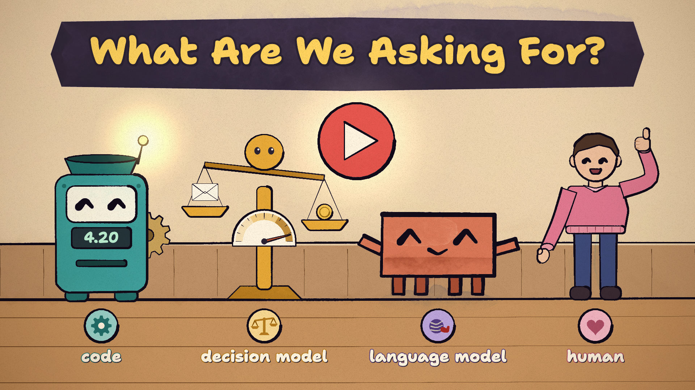
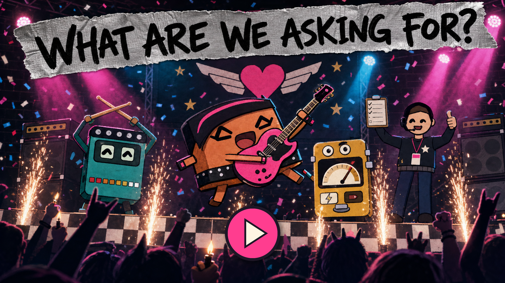

# jev-learnings

What we learned building with Jev, TypeSafe's judgment model, in two projects. One was an email first pass over a personal inbox. The other was an agent that plays the idle game Melvor Idle through a web browser for days at a time. Both use Jev the same way: as a cheap, fast judgment tier between deterministic code and an expensive LLM.

This repo holds only generalized findings: rates, AUCs and patterns. It contains no mail, no personal data and no game save.

## The website: Decision Tier

**[robgruhl.github.io/jev-learnings](https://robgruhl.github.io/jev-learnings/)** turns these findings into a tutorial site that runs from explain-like-I'm-five to engineering:

- **Learn:** [ELI5](https://robgruhl.github.io/jev-learnings/eli5.html), [101](https://robgruhl.github.io/jev-learnings/101.html), [201](https://robgruhl.github.io/jev-learnings/201.html), [301](https://robgruhl.github.io/jev-learnings/301.html).
- **Architecture:** [the cascade](https://robgruhl.github.io/jev-learnings/cascade.html) and [novelty and doubt](https://robgruhl.github.io/jev-learnings/novelty-and-doubt.html).
- **Case studies:** the Melvor agent in four pages: [the testbed](https://robgruhl.github.io/jev-learnings/melvor.html), [why a game](https://robgruhl.github.io/jev-learnings/melvor-why.html), [the cascade, built](https://robgruhl.github.io/jev-learnings/melvor-cascade.html) with color-coded pseudo-code, and [push-downs](https://robgruhl.github.io/jev-learnings/melvor-pushdowns.html) (65 resolved escalations and where each fix landed). The email first pass in four pages: [the testbed](https://robgruhl.github.io/jev-learnings/email.html), [asking the right questions](https://robgruhl.github.io/jev-learnings/email-questions.html), [the sorter, built](https://robgruhl.github.io/jev-learnings/email-sorter.html) and [around the sorter](https://robgruhl.github.io/jev-learnings/email-beyond.html), counts and rates only.
- **Evidence:** [four ways compared](https://robgruhl.github.io/jev-learnings/compare.html) (Jev, OpenAI's Decisions API, open-weight decision models, Claude Haiku 5.5), [open weights caught up](https://robgruhl.github.io/jev-learnings/open-weights.html) (six 26–27B open models against Jev, October 14), [the cost ladder](https://robgruhl.github.io/jev-learnings/cost.html) with a calculator, and an [October 2026 landscape refresh](https://robgruhl.github.io/jev-learnings/landscape.html).
- **Build:** [the Decision Skeleton](https://robgruhl.github.io/jev-learnings/build.html), a facilitated Claude Code tutorial in [`tutorial/`](tutorial/101-decision-skeleton.md). Run `cd tutorial && claude` to start it.

The site source is `site/` (page fragments plus a template). `python3 site/build.py` writes `docs/`, which GitHub Pages serves, and fails on any broken relative link.

## The sing-along guide

[**What Are We Asking For? A sing-along guide to code, models and humans**](docs/media/what-are-we-asking-for-540p.mp4) is a 4½-minute karaoke video (540p). The full 1080p version is on the [sing-along release](https://github.com/RobGruhl/jev-learnings/releases/tag/singalong-v1). It teaches the same cascade: deterministic code for rules you can write down, a decision model for bounded judgments, a language model for open questions, and a human for stakes and values. The chorus is the whole idea: *match the tool to the work we do, and let the real world tell us what holds true.*

The song is Suno-generated (voice and piano). The animation was made with Claude Code on [ClaudeAnimationBase](https://github.com/JohnHeibel/ClaudeAnimationBase).

[**What Are We Asking For? (Name the Job, Then Light the Spark)**](docs/media/what-are-we-asking-for-rock-540p.mp4) is the pop-punk version: a 3¼-minute karaoke video (540p) with new lyrics on the same lesson, set in a mid-2000s rock club. Clawd is the frontman (the language model), a drum machine plays the code, a guitar tuner that can only snap to the options it was given plays the decision model, and the stage manager makes the human call on the pyro. The chorus: *name the job before we light the spark, and let the real world keep the score.* The song is Suno-generated, the animation was made with Claude Code on the same kit, and the thumbnail was made with gpt-image-2.

## The shape both projects converged on

| Tier | Speed | Job | Passes up when |
| --- | --- | --- | --- |
| Guards (code) | ~1 s | Safety only: stop or protect, never decide | Never; they act and log |
| Code | Per step | State extraction, legal options, planning from data, verification, policies with computable answers | A step can't be found, or verification fails |
| Jev | ~0.5–5 s, fractions of a cent | Narrow judgments with no computable answer: which target matters, is this worth it, is this mail an obligation | Its own checks fire (novelty, doubt), or the failure isn't transient |
| LLM (Claude) | Minutes, woken by events | Inspects, decides, and **fixes the cause in a lower tier** | Real money, accounts, irreversible actions, the human's preferences |
| Human | Hours | Preferences, approvals, gray-zone rulings | — |

## Read next

- [cascade.md](cascade.md): running Jev inside a code → Jev → LLM → human cascade. What escalates, what doesn't, and how each escalation becomes a lower-tier fix.
- [novelty-and-doubt.md](novelty-and-doubt.md): the decision model's own escalation signals. What `novel_situation` and `doubt_action` each catch, what the readings under the threshold mean, and what doubt can't see.
- [questions.md](questions.md): how to phrase questions for Jev. Choices that name near misses, exact Nouls, when not to decompose.
- [using-answers.md](using-answers.md): answers as features rather than judges, gates, and why facts beat more questions.
- [evaluation.md](evaluation.md): honest evaluation. Freeze before held-out runs, label blind, validate on a new window.
- [models.md](models.md): hosted Jev against a local open-weights Jev, a 2B decider model, a 27B open decision model, and a small general LLM on the same tasks. The site's [four-way comparison](https://robgruhl.github.io/jev-learnings/compare.html) adds OpenAI's Decisions API and Claude Haiku 5.5.

## The ten-line version

1. Put each kind of decision in the cheapest tier that can make it correctly. Code first, Jev for judgment, the LLM for novelty, the human for preference.
2. When Jev is wrong in a consistent direction, or the question has a computable answer, move it to code.
3. Jev judges the decision against the state it is shown. It cannot see a consequence the state doesn't contain, so code must put that consequence in the state.
4. Jev's doubt is good evidence when it is high. Bugs often sit just below the escalation line, though, and the worst ones never reach Jev at all: they are planner gaps where every option offered was bad.
5. A playbook line turns a novelty escalation into a confident decision next time. One sentence of context moved doubt from 0.71 to 0.35.
6. Verifiers must check outcomes (count went up), not starts. They must also accept deliberate stops as success.
7. In an agent loop, LLM wakes are the scarce resource. Batch sizes, restock sizes and how often "nothing to do" happens decide the wake rate.
8. Prefer one contrastive Choice whose options name the near misses. Grade every question against its own concept.
9. Use answers as features in a learned combiner, not as hard thresholds. Validate on a new time window, not just cross-validation.
10. Safety belongs in the fastest tier, and the environment (tabs, focus, disconnects) is its own failure class.
