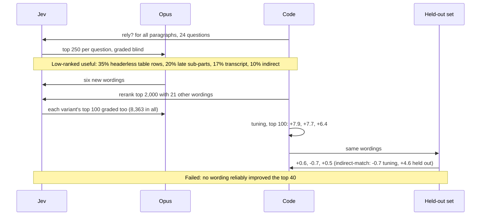
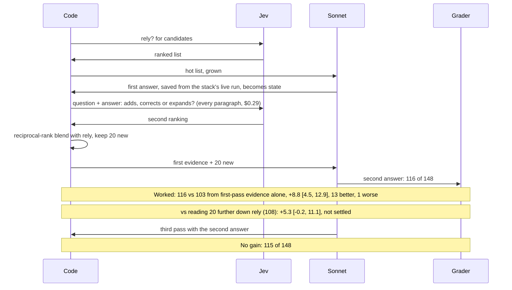

# Searching a corpus with code, a decision model and an LLM

What we learned using Jev to find information and answer questions across a corpus: which tier does what, what moved results, what did not, and how far to trust it. The site's [six-page case study](https://robgruhl.github.io/jev-learnings/search.html) has the same findings with charts, the search video and pseudo-code.

The main test corpus is public sources about one large retailer: 1,955 documents and 28,167 searchable paragraphs, from 2002 to October 2026. It holds press releases, wire releases, a partner's filings and calls (some in a second language) and machine transcripts of a podcast. An earlier run used 200 open textbook chapters (20,585 paragraphs). Experiment code and corpus text stay in a private repo, because the text is other people's copyrighted work. This page holds numbers, patterns and our own prompts only.

Models: `jev-1.14.0` at $0.042 per million input tokens; Claude Haiku 5.5, Sonnet 5.5 and Opus 5.5. Measured October 31 to November 1, 2026.

## The short version

The stack works, and its shape is a loop rather than a one-way funnel. Jev reads everything, code adds exact lookups and blends rankings, and an LLM writes a draft that sends Jev back for one more pass.

```text
1. Jev reads every paragraph; code adds a name grep
2. Jev grows the top paragraphs into passages; the LLM writes a draft
3. Jev rereads its top 2,000 with the draft in hand; code blends the two rankings
4. The top new passages are added; the LLM writes the final answer
```

The pieces were tested separately, not this exact sequence. The answer test in finding 5 started from a keyword-gated first pass and added paragraphs from the full-read blend. The full-read-first version has run on one real question and was not scored against gold.

## How we measured

- 24 gold questions with 148 required facts, split by seed into 16 tuning questions (97 facts) and 8 held out (51 facts).
- Answers were scored fact by fact and blind, twice, with a third pass on ties.
- Paired bootstrap intervals and sign tests, so intervals below are in points of fact recall per question unless stated.
- "Facts stated of 148" and "facts stated of 51" come from different writers and scorers. Compare arms only inside one table.

## Core findings

**1. The stack is faster than an LLM alone on material outside its memory, and probably reaches more.** With no evidence, Sonnet stated 0 of 76 facts dated after its cutoff and 1 of 72 before it, though partial memory reaches about 16 of those 72. On the 8 held-out questions:

| Arm | Facts stated of 51 | Median total | First words | Median cost |
|---|---|---|---|---|
| The stack | 27.0 | 14.3 s | 5.1 s | $0.103 |
| The tuned stack | 26.0 | 14.1 s | 5.0 s | $0.129 |
| LLM alone with grep and read | 14.0 | 21.1 s | 15.5 s | $0.093 |

The speed result is firm: first words came sooner on all 8 questions, and the full answer finished sooner on 7. The fact lead is less firm: +26.0 points [8.6, 41.2], better on 6 questions and worse on 1. It is probably generous, because the LLM-alone arm stopped early (a median of 5 turns of 12) and was not pushed to search harder. An earlier closed-book run over all 24 questions showed a lead of about 5 points [-4.6, 14.7]. The LLM-alone cost depends on prompt caching: about $0.17 without it, by estimate.

**2. Jev works best as the reader, not as a filter after keyword search.** One pass over all 28,167 paragraphs cost $0.233 (5.56M tokens, about 140 calls). A rested pass took about 2 s; back-to-back passes took 7 to 12 s with hundreds of throttles, about 600,000 tokens a second sustained. The account's documented limit is 100,000 tokens a second, which would make the same pass about 56 s, so don't plan on the burst rate.

**3. Code is risky as a gate and valuable alongside Jev.** How many of the 148 facts each list was credited with:

| List | Facts |
|---|---|
| BM25 top 5,000, question words only | at least 99 |
| BM25 top 5,000, Haiku's search terms | at least 117 |
| BM25 top 5,000, Sonnet's search terms | at least 124 |
| Jev full read, top 40 | 96 |
| Jev full read, top 100 | 113 |
| Jev full read, top 250 | 129 |

The BM25 figures are floors and can't be compared with Jev's: only graded paragraphs could count, the grading pool came mostly from Jev's lists, and 95 to 97% of each BM25 list was never graded. They do compare with each other, so better terms clearly helped. The firmer evidence is a trace: BM25 reached only 6 to 12% of podcast paragraphs on one question, because spoken paragraphs often never name their subject. On that trace, seven fact paragraphs ranked 1, 2, 4, 34, 52, 73 and 134 when Jev read everything. The reliable jobs for code are grep for names, date filters, deduplication, blending and bookkeeping.

**4. How far down you read matters more than how you ask.** Facts in the `rely` list went from 96 at top 40 to 109 at 60, 113 at 100 and 129 at 250. Sixteen ways of asking and six proposed by Opus, tested on 8,363 graded paragraphs, did not reliably improve the top 40. Only `rely` plus a graded Score held on both question sets, and that gain was small.

Blending many wordings for the same paragraph helps modestly, mostly past the top 40. Change in useful paragraphs against `rely`:

| Blend | Top 40 | Top 100 | Facts at 40 / 100 |
|---|---|---|---|
| `rely` alone | | | 96 / 113 |
| Max of all | +2.4 | +4.1 | 97 / 114 |
| Mean of logits | +1.6 | +5.7 | 96 / 121 |
| Logistic, out of sample | +1.9 | +7.0 | 98 / 121 |
| CatBoost, out of sample | +3.1 | +9.2 | 109 / 124 |

CatBoost also saw source, length, digit share and heading, and would need refitting on another corpus. Trained on 16 questions and judged on the other 8, it gained +1.1 at top 40 and +4.1 at top 100. The 20 extra wordings cost about $0.41 a question on the top 2,000, about 2 cents each.

**5. A draft answer makes Jev a much better second reader.** This was the strongest pipeline gain. Give Jev the question and a first answer, ask how each paragraph relates to that answer, and blend the result with the first ranking by reciprocal rank.

The two statements, verbatim:

```text
This paragraph states something an answer to the question in `question` would rely on.

Compared with the answer in `answer`, this paragraph adds something missing, contradicts or corrects it, or expands on it, in a way that matters for the question in `question`.
```

| Added paragraphs | Missed facts found of 65, reading further | Missed facts found, blend | Questions better / worse |
|---|---|---|---|
| 20 | 15 | 28 | 10 / 0 |
| 40 | 20 | 31 | 10 / 2 |
| 60 | 24 | 32 | 7 / 2 |

Replaying saved scores, rereading the top 2,000 found as many missed facts as rereading everything, for about $0.02 instead of $0.29. Statements that only asked about adding or only about contradicting did little, and the combined statement alone did less than the blend.

At the answer level, with one writer and one scorer across arms. This test started from a keyword-gated first pass, used a saved first answer as the draft, and used the full $0.29 reread, so its gain also includes reaching the full read:

| Arm | Facts stated of 148 |
|---|---|
| First-pass evidence | 103 |
| Plus the next 20 on the list | 108 |
| Plus 20 from the draft-aware blend | 116 |
| Plus 20 more from a third pass | 115 |
| Second pass plus 20 from terms the writer suggested | 118 |

Second pass against first: +8.8 points [4.5, 12.9], 13 questions better and 1 worse, p .002. Against simply reading further: +5.3 [-0.2, 11.1], so that edge is unsettled. A third pass added nothing (-0.8 [-4.7, 3.2]). Earlier second passes with no draft barely helped, which suggests the draft matters: an aimed gap wave added 1.7 points of evidence, and letting an LLM aim it added 1. Those used a different stack and an evidence-only measure.

**6. Jev is good glue for passage boundaries.** Growing a hot paragraph with Jev deciding each boundary averaged 2.95 paragraphs a passage, and 32% stayed single. Turning growth off lost 13.4 points of evidence. Always adding neighbours would add about 67 paragraphs and 33k characters an answer and rarely help. Of 36 facts missing from first-pass evidence, 3 sat next to the evidence, 4 two away, 7 further along the same document, 16 in a document with no evidence yet, and 6 had no graded paragraph.

**7. Spend the LLM on judgment and writing.** The writer takes most of the time, about 10 of 14 s, and a Haiku writer lost 13 points. Sonnet's search terms beat Haiku's for BM25 (+8.2 points [2.5, 13.8] of useful paragraphs), and question splitting tied.

An Opus orchestrator, given a toolbox and a playbook of these findings, tied the pipeline:

| Arm | Facts of 148 | Median words |
|---|---|---|
| Pipeline with second pass, Sonnet writes | 116 | 675 |
| Same evidence, Opus writes | 115 | 560 |
| Opus chooses its own search | 116 | 488 |

Against the Opus-written pipeline: +0.7 points [-8.8, 9.4], 9 questions better and 7 worse. The wide interval is the finding. Against the Sonnet-written pipeline, 100 facts were stated by both, 16 only by the orchestrator, 16 only by the pipeline, and 16 by neither, so together they reach 132 of 148. Some of that is noise, since repeat runs of one design flip 16 to 20% of verdicts, but the two differ on 32 facts against 13 between the pipeline and its third-pass arm. That hints that diversity is worth more than autonomy. A merged answer has not been tested.

It took a median of 17 steps and 73 s from first to last tool call, about 17 s of that in tools. It used grep on all 24 questions, a draft-aware pass on 23, BM25 on 22, blends on 19 and facets on 3. It often limited Jev by date, and it never used title routing or chunk growth. Its Jev spend was a median of $0.20 real, or about $0.41 if full reads served from cache are priced normally.

Costs per question, both estimates and neither timed end to end: about $0.40 for the pipeline with the $0.02 reread (nearer $0.67 as scored, with the $0.29 reread), and about $1.30 for the orchestrator with prompt caching. The orchestrator figure comes from 22 run transcripts, a median of about 750k input tokens and 9.4k output, and assumes standard cache pricing. Without caching it would be about $3.60.

**8. Source structure is now the main constraint.** Opus's rough count of useful paragraphs ranked low: 35% table rows or footnotes with headers cut off, 20% a late part of a many-part question, 17% spoken or garbled transcript, 10% an indirect reference to the subject.

| Source | Paragraphs | Split mid-sentence | Other unfinished endings | Read |
|---|---|---|---|---|
| Wire releases | 4,669 | 0.1% | 2.2% | Clean |
| Press room | 9,194 | 0.8% | 26.8% | Flattened tables and contact lines |
| Partner filings | 6,070 | 0.2% | 16.9% | Table rows lose column headers |
| Podcast transcripts | 8,081 | 7.0% | 1.1% | No speakers or headings; misheard names |

Wording cannot fix what Jev is not shown. Rebuilding tables and transcripts is the next step, and it changes every paragraph id, so baselines must be rerun.

**9. Don't rely on an "is this enough?" gate.** On the textbook corpus, a sufficiency Noul barely noticed when a whole source was removed: pooled AUC about 0.55, median drop 0.013, against a between-question spread of 0.123. Part-level drops can point at a gap once one exists, but no general gate worked. A fixed single second pass is the safer rule for now.

**10. Evaluation fooled us repeatedly.**

- A tuned design scored 69 against 52 on tuning questions and 26 against 27 on held-out ones. With over 40 variants on 16 questions, the winner is flattered by selection.
- With paired SD near 24 points, 16 questions detect gains of about 15 points and 8 questions about 25.
- A two-way judge favored the answer shown second in 32 of 35 verdicts.
- Two graders disagreed enough (72 against 52 useful of 192) that a comparison had to be thrown out and everything regraded by one grader.
- One wave silently returned 4,624 of 4,919 answers with no error. Check that every paragraph came back.
- Wording moved the share of paragraphs scoring 0.5 or more from 0.8% to 12.9%, so a fixed hot threshold belongs to one wording. Use ranks.

## What did not help

- Deeper BM25 between 5,000 and 10,000, and per-source quotas (forcing six paragraphs from each source lost 10 points).
- Chapter or document routing on this corpus. On textbooks, one-paragraph summaries routed well, but here title routing did no better than reading fewer BM25 hits, so summaries were never built.
- A third pass, and search terms suggested after the second pass (more ground, about the same facts).
- Writer ordering, dense prompts, listing the parts for the writer, and a cheaper writer.

## How far to trust this

- Only finding 1 and part of the CatBoost result come from questions set aside for testing, and all 24 have now been inspected. Findings 3 to 7 are directional until tested on 40 or more fresh questions.
- The playbook held results from these same questions and recommended the second pass, so the orchestrator is not independent of the pipeline.
- Gold was written with knowledge of the sources, and strict scoring undercounts. 500 words is also a tight limit: an evidence check finds about 40 facts where 26 are stated.
- Times are one machine, one account and sequential runs. Subagent time is not API latency.
- 28,000 paragraphs is not very large. At 1M paragraphs, a full read projects to about $8 and takes over 5 minutes at the 600k tokens a second we saw on short passes, or about 33 minutes at the documented limit. So a prefilter probably has to return. How to build that prefilter without losing what BM25 loses is the biggest open question.
- Hosted Nimble takes Jev's request shape and costs about the same, but it has not been tested on this work.

## Wording and blending, in detail

The site's [wording and blending page](https://robgruhl.github.io/jev-learnings/search-wording.html) has every statement verbatim with its results. In brief:

- **22 ways of asking.** Besides `rely`, eight came from the repo's existing wording list (four of them compared on the textbooks), seven were added for this test (including a graded Score, a four-way Choice and two that show the previous paragraph), and Opus proposed six after studying what `rely` ranked badly. Each reranked `rely`'s top 2,000; Opus graded 8,363 paragraphs blind to rank. Asking `rely` again moves about one point.
- **Tuning winners didn't hold.** At top 100, `rely` plus not-boilerplate gained +7.9 on tuning questions and +0.6 held out; four-way Choice +7.7 and −0.7; graded Score +6.4 and +0.5. Opus's indirect-match did the reverse, −0.7 and +4.6. Of the single wordings and ten pairings with `rely`, only `rely` plus a graded Score, log-odds summed, had intervals above zero on both sets: +4.3 [2.5, 6.2] and +2.1 [0.5, 4.3].
- **Why wording probably can't fix most misses** (Opus's rough shares on tuning questions; the explanation is untested). Of about 180 low-ranked useful paragraphs: 35% table rows or footnotes with headers cut off, 20% late parts of multi-part questions, 17% rough transcript, 10% indirect references. Of about 110 high-ranked useless ones: 27% background that names the right entities, 23% boilerplate, 18% the wrong period or instance, 12% method text or tables cut before the answer row, 11% the same keyword for another entity, 9% off-topic talk.

Blends of 21 wordings (all but the one that failed as a ranker), scored one pass per wording and blended offline, all 24 questions, change in the share of useful paragraphs found, in percentage points, against `rely`. The learned blends were judged one question at a time, trained on the other 23:

| Blend | How it works | Top 40 | Top 100 | Better / worse at 40 |
|---|---|---|---|---|
| Max of probabilities | Best answer from any wording | +2.4 [0.4, 4.7] | +4.1 [1.6, 6.8] | 10 / 9 |
| Max of z-scores | Standardize, then best | +1.4 [−0.9, 4.0] | +5.7 [2.1, 10.3] | 7 / 11 |
| Median of z-scores | Middle answer | +0.9 [−0.7, 2.8] | +4.9 [2.6, 7.3] | 9 / 6 |
| Reciprocal rank | Sum of 1 / (60 + rank) | +1.0 [−0.4, 2.6] | +5.0 [2.6, 7.5] | 13 / 5 |
| Mean of z-scores | Average after standardizing | +1.5 [−0.2, 3.5] | +5.5 [2.8, 8.7] | 14 / 5 |
| Mean of log-odds | Average evidence | +1.6 [−0.1, 3.7] | +5.7 [3.0, 8.9] | 14 / 5 |
| Mean of top 3 z-scores | Between max and mean | +1.0 [−1.0, 3.3] | +5.9 [2.7, 9.9] | 10 / 8 |
| Logistic regression | Learned weights on z-scores | +1.9 [−0.1, 4.1] | +7.0 [3.7, 10.6] | 14 / 5 |
| CatBoost ranker | YetiRank on z-scores plus source, length, digit share, heading | +3.1 [0.8, 5.7] | +9.2 [5.5, 13.9] | 14 / 5 |

Trained on the 16 tuning questions and judged on the 8 held out, at top 100: mean of log-odds +2.8 [0.7, 6.0], reciprocal rank +2.8 [0.6, 6.1], logistic +4.3 [0.2, 8.9], CatBoost +4.1 [1.4, 7.2], `rely` plus two or four wordings chosen on tuning +1.2 and +1.3. CatBoost also saw source, length, digit share and heading and was never tested without them. Logistic weights (from the tuning-only fit) are not a ranking of wordings: "help" got −0.85 and "evidence" −0.73, probably because correlated wordings split the credit (not checked).

The draft-aware second pass is a blend too. Missed gold facts found in 20 added paragraphs, of 65: reading further down `rely` 15, "corrects" alone 15, "adds" 18, "expands" 18, the max of those three 19, one combined statement 21, and the combined statement blended with `rely` by reciprocal rank 28. One statement naming all three beat the max of three on missed facts, though not on useful paragraphs, and blending with the old ranking beat replacing it. The blend was chosen after seeing the results of seven methods.

Untried: putting the paragraph in the state and asking the wordings as questions (one paragraph of about 200 tokens plus 21 short statements, about 830 tokens, against 21 copies of the paragraph, about 4,200; but one request per paragraph), weighted reciprocal rank, choosing wordings per question, and blending across models.

## Six episodes as sequence diagrams

The site's [successes and failures page](https://robgruhl.github.io/jev-learnings/search-stories.html) draws these with the tier colors. Text versions:

**1. Failed: "is this enough?"** (textbook corpus)

```mermaid
sequenceDiagram
    participant C as Code
    participant J as Jev
    participant M as Measure
    C->>J: full evidence: enough to answer?
    J->>M: mean 0.766, SD between questions 0.123
    C->>C: remove one intended chapter (77) or a placebo (76)
    C->>J: the same statement
    J->>M: median knockout drop 0.013 (placebo mean drop 0.005)
    Note over C,M: Failed: pooled AUC 0.555 [0.51, 0.63]
    C->>J: per part: does the evidence state this part?
    J->>M: weakest part is the one that fell, 10 of 11 big gaps
    Note over C,M: Points at the gap, but needs a full copy; as a gate AUC 0.533
```

**2. Failed: a tuning win that didn't hold**

```mermaid
sequenceDiagram
    participant E as Experimenter
    participant S as Stack
    participant G as Grader
    participant H as Held-out set
    E->>S: five waves, over 40 variants, 16 questions
    S->>G: evidence checks for all, answers for some
    G->>E: part-balanced hot list: 69 vs 52 (one pass)
    E->>S: rerun live, two passes
    G->>E: 63 vs 54, +9.1 [2.8, 16.5]
    E->>H: 8 questions no wave saw, two runs
    H->>E: 26.0 vs 27.0 of 51
    Note over E,H: Failed: no gain held out (69 to 63 looks like selection plus noise); defaults unchanged
```

**3. Worked: tracing one weak answer to the keyword gate**

```mermaid
sequenceDiagram
    participant Hk as Haiku
    participant C as Code
    participant J as Jev
    participant W as Sonnet
    participant E as Experimenter
    Hk->>C: search terms and parts
    C->>C: BM25 keeps the best keyword hits (a gate)
    C->>J: rely? for each kept paragraph
    J->>C: scores; hot list of 60, grown by Jev
    C->>W: evidence
    Note over W,E: Failed: 2 of 7 facts
    E->>C: where did each missing fact sit?
    Note over Hk,J: Gold documents in evidence, paragraphs for 4 of 7 facts not; the untuned run through the same gate held most; BM25 reached 6-12% of podcast paragraphs
    E->>J: read all 28,167 paragraphs, no gate
    J->>E: about 2 s rested, $0.233
    Note over J,E: Worked: fact paragraphs rank 1, 2, 4, 34, 52, 73, 134 (a later full read: 1 to about 180)
```

**4. Failed: hunting for a better wording**



**5. Worked: a second pass that reads the draft**



Replaying saved scores, the combined statement on `rely`'s top 2,000 found the same facts as on every paragraph, for about $0.02.

**6. Draw: Opus runs its own search** (one real run, 17 calls in about 50 s)

```mermaid
sequenceDiagram
    participant O as Opus
    participant C as Code tools
    participant J as Jev tools
    participant G as Grader
    O->>J: full read with rely (cached)
    O->>C: BM25; read 4, 4, 2 paragraphs, each with neighbours
    O->>J: its own statement on 1,761 paragraphs
    O->>C: read, grep x2, read
    O->>J: draft-aware statement on 2,000
    O->>C: blend, read, grep, BM25, grep, read
    O->>G: the answer
    Note over O,G: 116 of 148 each over 24 questions, 100 shared; union 132; est. about $1.30 vs about $0.67 for the pipeline as scored, not measured end to end
```

## Next

1. Rebuild tables and transcripts, then rerun baselines.
2. Write 40 or more fresh questions, frozen before any run.
3. Test a merged answer from the pipeline and the orchestrator.
4. Test the recipe live for latency and cost, and push the LLM-alone arm to search harder.
5. Test a prefilter at a corpus about ten times larger.
